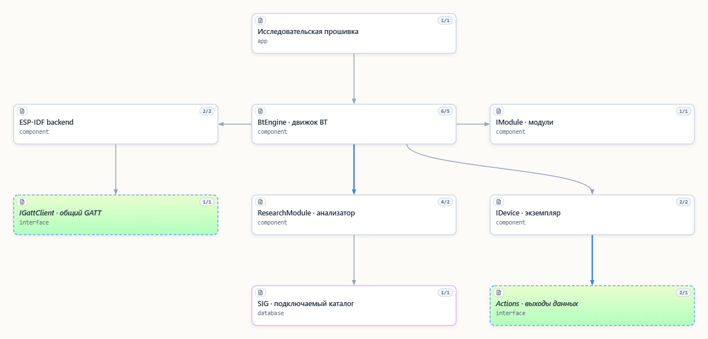
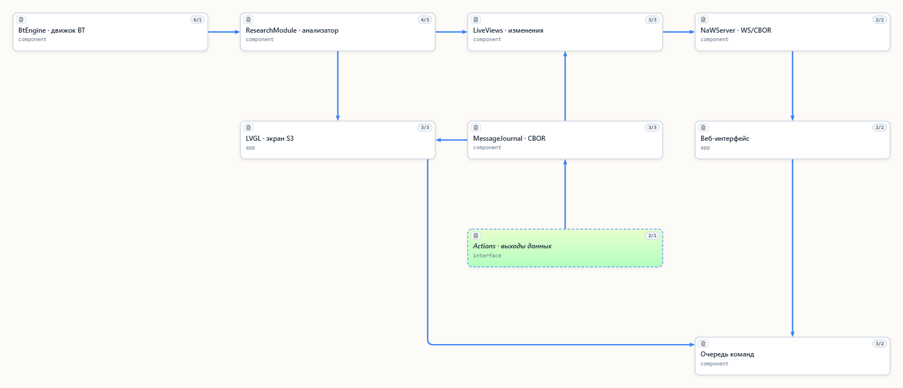

# NaBTools

[Русский](Readme.ru.md) · [Repository](https://github.com/NaBrIks/NaBTools)

An experimental C++20 Bluetooth toolkit for ESP32: radio mechanisms, borrowed
and owned packet views, protocol modules, device instances and research tools.
Extracted from the Bluetooth library in ESP32-BLETPMS-and-more.



## What it does

- `BtEngine` owns an injected backend, modules and bounded device instances.
  Applications decide which devices to admit/remove and provide output Actions.
- GAP AD/UUID views preserve repeated and unknown fields. Owned advertisements
  include raw bytes and controller metadata; callback buffers are never retained.
- Advertising classification reports type, advertised capabilities, evidence,
  uncertainty/conflicts and limits. A company ID alone does not identify a type.
- The ESP-IDF backend supports passive/active scanning, configurable interval/window
  and asynchronous stop/configure/resume. Active scanning does not connect or pair.
- Optional generic GATT discovery/read/write/subscribe is separate from profiles.
- TomTom TPMS, standard Heart Rate and experimental Samsung SmartTag modules have
  independent typed STRUCT and direct CBOR Actions. No universal payload DOM is required.
- Optional SIG name catalogs: OFF, COMMON, EXTENDED, FULL (15 supported categories).
  Raw values remain useful without catalogs; FULL is not the entire SIG/GSS corpus.
- The research example provides a compact generic web UI over WS/CBOR. Snapshots,
  updates, commands and results share one transport; HTTP serves static assets.
  A separate S3 LCD7 profile adds an optional LVGL display.

## Status and limitations

Version 0.3.0; APIs are experimental. The retired flat implementation is removed:
use feature headers and `NaBTools::runtime`. No former-name aliases are maintained.
Real Heart Rate notifications and SmartTag owner authentication/start sound were
observed in earlier hardware tests. SmartTag button events/reliable stop sound,
new active-scan behavior and dynamic timing changes are **not hardware-accepted**.
Host tests and firmware builds do not prove radio/display behavior.

Advertising storage is bounded (255 bytes per owned packet; 32 research rows).
Extended advertising reassembly is not implemented. Generic classification is
selective, not an authenticated device identity or a complete capability inventory.
Classic/SDP, audio and full Mesh transport are not implemented. Timings below
request RF windows; coexistence can preempt them. Filesystem ownership, fleet
configuration, durable settings and application web servers stay in applications.
The library does not mount/format a filesystem or erase NVS.

## Dependencies

| Scope | Dependencies |
|---|---|
| Portable runtime/native tests | C++20 STL, CMake 3.16+, compiler; Windows owner-crypto test uses CNG/bcrypt |
| Hardware backend | ESP-IDF Bluetooth/Bluedroid and esp_timer; baseline ESP-IDF 5.5.6 |
| Research firmware/web | Historical HTTPD-compatible [NaWServer revision](docs/readme_nawserver_ru.md), ESP-IDF Wi-Fi/network/NVS/mbedTLS |
| Optional `s3_lcd7` | LVGL 9.6.0, espressif/cbor 0.6.1~4 (TinyCBOR), esp_lcd_touch 1.2.1, GT911 1.1.3 |
| SIG regeneration | Python 3.10+ and PyYAML 6.0.3; optional pinned Bluetooth SIG submodule |
| Browser tests/preview | Node.js 24 recommended; `npm ci` installs locked cborg/jsdom/ws and their dependencies |
| PlatformIO examples | Core 6, Espressif32 8.0.0; toolchains 14.2.0+20260121 and prepared shared ESP-IDF 5.5.6 |

NaWServer, LVGL, TinyCBOR and browser tooling are not dependencies of portable
packet parsing. No sibling checkout is required for the link-only smoke example.
See [environment setup](docs/readme_development_environment_ru.md) for exact SDK
preparation: the `symlink://` SDK pin is deliberate and is not downloaded by
cloning this repository. Installing tools/managed components may require network access.

## Build from a clean checkout

Clone this repository with the directory name `NaBTools`; the ESP-IDF component is named from it.

```sh
git clone https://github.com/NaBrIks/NaBTools.git NaBTools
cd NaBTools
cmake -S . -B local/native-build
cmake --build local/native-build --config Debug
ctest --test-dir local/native-build -C Debug --output-on-failure
npm ci --ignore-scripts
npm test
```

CTest generates the native CBOR fixtures consumed by browser tests. On Windows,
Visual Studio 2022 is a supported CMake generator. The Windows-specific crypto
test is omitted on other hosts. The default OFF profile builds without initializing
the Bluetooth SIG submodule. To generate and test the optional name tables:

```sh
git submodule update --init --checkout -- bluetooth-SIG
python -m pip install -r tools/requirements.txt
python tools/generate_sig.py
python tools/generate_sig.py --check
cmake -S . -B local/native-build -DNABTOOLS_TEST_SIG_PROFILES=ON
cmake --build local/native-build --config Debug
ctest --test-dir local/native-build -C Debug --output-on-failure
python -m unittest discover -s tests/tools
python -m unittest discover -s tests/devices/samsung/smarttag -p owner_key.py
```

After preparing the documented shared SDK/toolchains:

```sh
pio run -d examples/espidf_smoke -e s3
```

This links the current library without LVGL/web and never starts the radio.
The research firmware requires a sibling NaWServer checkout with the historical
HTTPD API. See [research integration](docs/readme_nawserver_ru.md) before running `pio run -d examples/research -e c6` or `-e s3_lcd7`.
The `c6_idf61` environment builds the C6 research example with ESP-IDF 6.1.0
and RISC-V GCC `15.2.0+20251204`. Run `pio run -d examples/research -e c6_idf61`.
The `c6` and `s3_lcd7` environments select ESP-IDF 5.5.6.
Private Wi-Fi headers are optional; without them the build uses empty credentials.
Build commands do not upload firmware or an FS image. Never use an example's
partition table to replace application data without a separate deployment decision.
`npm run preview` serves synthetic fixtures only, on loopback port 5279.

## Use as an ESP-IDF component

Add the NaBTools directory to `EXTRA_COMPONENT_DIRS` before including ESP-IDF's
`project.cmake`, and use `REQUIRES NaBTools` in the application component.
Pin a full Git commit for reproducible consumers; do not depend on an unpublished
working tree. The final published revision is obtainable with `git rev-parse HEAD`.
The root CMake source list includes classification and the current SDK backend.

Public headers include `<NaBTools/bt/engine.hpp>`,
`<NaBTools/bt/gap/ad_view.hpp>`, `<NaBTools/bt/gap/classification.hpp>`,
`<NaBTools/research/research.hpp>` and device/profile feature paths.
Include `<NaBTools_espidf.hpp>` for `EspIdfBackend`/`EspIdfScanTiming`.
`set_scan_timing` accepts interval/window in 0.625 ms units (library range
4..0x4000, window <= interval). `scan_timing()` reports **applied** timing;
before first completion it is `{0,0}`. Use `requested_scan_timing()` and
`scan_timing_pending()` to distinguish an accepted request from application.
Application/engine calls and these getters are serialized in the owner context.

`library.json` supplies portable sources for PlatformIO consumers providing their
own backend. Hardware ESP-IDF users should use the component, which includes
SDK adapters and Kconfig. No static recognizer registration or nlohmann-json remains.

## Research data flow



## Documentation and examples

- [Research example sources](examples/research/README.md), [optional LCD7](examples/research/display/research_lcd7/README.md).
- [Runtime](docs/readme_runtime_ru.md), [advertising classification/scan modes](docs/readme_advertising_classification_ru.md), [GATT](docs/readme_gatt_ru.md).
- [WS/CBOR](docs/readme_websocket_ru.md), [output levels](docs/readme_output_levels_ru.md), [file layout](docs/readme_layout_ru.md).
- [SIG maintenance](docs/readme_sig_update_ru.md), [device lifetime/outputs](docs/readme_sig_outputs_bt_ownership_ru.md).
- [Heart Rate](docs/readme_hrm_ru.md), [SmartTag GATT](docs/readme_smarttag_gatt_ru.md), [owner protocol](docs/readme_smarttag_owner_ru.md).
- [Handoff/status](docs/readme_handoff_ru.md), [SeMaps](docs/readme_semaps_ru.md), [retired-code audit](docs/readme_retired_code_ru.md).

Detailed guides are currently Russian. Dated proposals/extraction reports are
historical records, not claims that all proposed features are implemented.

## C/C++ formatting

For maintained C/C++ use the shared NaBrIks Uncrustify 0.83.0_f profile:
`python tools/format_cpp.py --list`, `--check` or `--apply`.
The formatter is installed separately and found through PATH, `UNCRUSTIFY`, or
`--uncrustify <executable>`. The Windows wrappers are `uncrustify-check.cmd` and
`uncrustify-apply.cmd`. See [English rules](agents/code_style.md) /
[Russian rules](agents/code_style.ru.md). Vendor/generated/SIG/SDK data are excluded;
JS/JSON are not C++ formatting targets. Do not run a second formatter.

## License and support

The project's own code is [MIT](LICENSE), by the rights holder's explicit decision
on 2026-10-30, including previously GPL-licensed own code. Source headers use
SPDX and the confirmed copyright identity; strict JSON/generated data are not
modified with comments. Historical grants remain in history.
The LCD7 `board.cpp`/`board.hpp` adaptation retains its GPL-3.0-only notice and
license; this does not imply foreign authorship merely from the prior GPL choice.
SIG material keeps its proprietary notices, Tabler icons keep Paweł Kuna's MIT
notice, and external components keep their own terms. The repository is not a
blanket MIT grant for these exceptions. See [the explicit inventory](docs/third_party.md).

Voluntary financial support does not require changing from GPL to MIT. No donation
URL or payment account has been configured; none is invented here.
