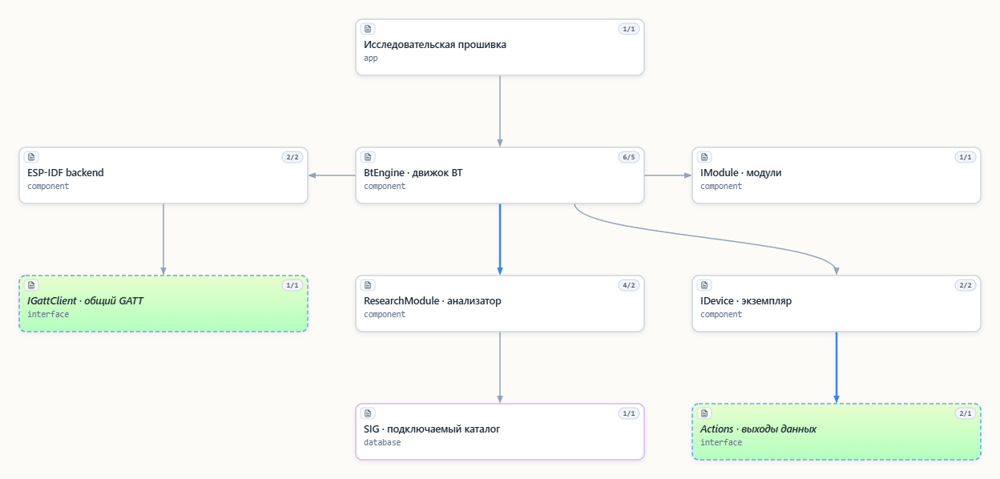
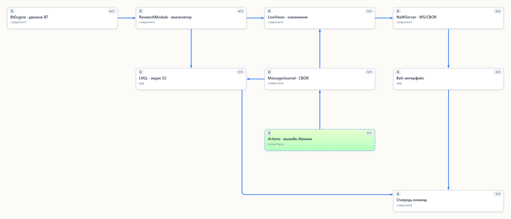

# NaBTools

[English](Readme.md) · [Происхождение и лицензионные границы](docs/third_party.md)

Самостоятельный проект для исследования Bluetooth, удобных C++-обёрток и
прикладных драйверов устройств. Выделен 2026-10-23 из
исходной Bluetooth-библиотеки проекта `ESP32-BLETPMS-and-more`.

Переименование проекта и современного API: [миграция в NaBTools](docs/readme_nabtools_migration_ru.md).
Репозиторий: [NaBrIks/NaBTools](https://github.com/NaBrIks/NaBTools).



Единая экспериментальная реализация на C++20:
BtEngine, модули исследования и TomTom TPMS, владение экземплярами устройств,
прямые STRUCT/CBOR Actions, Samsung SmartTag, стандартный Heart Rate,
ручное добавление экземпляров,
отключаемые SIG-профили и BLE backend ESP-IDF с опциональным GATT client.
Исследовательская прошивка отдаёт веб-интерфейс; весь прикладной обмен идёт
по WebSocket/CBOR. Снимок и изменения используют один формат.
Через универсальный GATT client получен реальный пульс Garmin в CBOR и вебке.
SmartTag поддерживает исследовательское GATT discovery и сырые indications;
owner-аутентификация, шифрованный звук и события кнопки реализованы экспериментально
в модуле Samsung. На EI-T5300 подтверждены owner-аутентификация и запуск звука;
реальные события кнопки и надёжная остановка звука пока не подтверждены.
Аудио пока не реализовано.

Классификатор рекламы показывает тип, возможности и основания, отличает
предположение по имени от Appearance/UUID и сигнатуры модуля. Он не создаёт
соединений. Backend поддерживает passive/active и настройку окна/интервала.
Смена режима/таймингов проверена fake SDK и сборкой, но ещё не принята на железе.
Владеющий пакет ограничен 255 байтами, исследовательская таблица — 32 строками;
extended reassembly, полные GSS-описания, Classic/SDP/audio/Mesh не реализованы.
Объявленный сервис не доказывает работу функции или тождество прибора.
Библиотека не монтирует/не форматирует FS и не стирает NVS.

## Внешние зависимости

| Область | Зависимости |
|---|---|
| Переносимое ядро/native tests | C++20 STL, CMake 3.16+, компилятор; Windows crypto-тест — CNG/bcrypt |
| Аппаратный backend | ESP-IDF Bluetooth/Bluedroid и esp_timer; базовая SDK 5.5.6 |
| Research-прошивка | Соседний [NaWServer, закреплённая ревизия](docs/readme_nawserver_ru.md), компоненты ESP-IDF Wi-Fi/network/NVS/mbedTLS |
| Только профиль s3_lcd7 | LVGL 9.6.0, espressif/cbor 0.6.1~4 (TinyCBOR), esp_lcd_touch 1.2.1, GT911 1.1.3 |
| Регенерация SIG | Python 3.10+, PyYAML 6.0.3; производные уже включены в Git |
| Web tests/preview | Рекомендуется Node.js 24; npm ci устанавливает cborg/jsdom/ws и транзитивные зависимости по lock |
| PlatformIO-примеры | Core 6, Espressif32 8.0.0, toolchains 14.2.0+20260121 и подготовленная общая ESP-IDF 5.5.6 |

NaWServer/LVGL/TinyCBOR и Node.js не требуются для переносимого разбора AD.
Точное [приготовление SDK](docs/readme_development_environment_ru.md) необходимо:
`symlink://` в INI не скачивает ESP-IDF при клонировании. Установка инструментов
и managed-компонентов может требовать сеть. Smoke не требует соседних библиотек.

## Проверка чистого checkout

Сохраняйте имя каталога NaBTools: от него получается имя компонента ESP-IDF.

```sh
git clone https://github.com/NaBrIks/NaBTools.git NaBTools
cd NaBTools
cmake -S . -B local/native-build
cmake --build local/native-build --config Debug
ctest --test-dir local/native-build -C Debug --output-on-failure
npm ci --ignore-scripts
npm test
python -m pip install -r tools/requirements.txt
python -m unittest discover -s tests/tools
python -m unittest discover -s tests/devices/samsung/smarttag -p owner_key.py
```

На Windows поддерживается генератор Visual Studio 2022. Windows-специфичный
crypto-тест не включён на других ОС. CTest создаёт CBOR fixtures в
`local/native-build`, нужные web-тестам. Рекомендуется закреплять полную Git SHA
при подключении к прикладной прошивке, а не использовать неопубликованное дерево.
Текущая ревизия checkout — `git rev-parse HEAD`.

- [Единый обмен WS/CBOR](docs/readme_websocket_ru.md)
- [Классификация по рекламе и активное/пассивное сканирование](docs/readme_advertising_classification_ru.md)
- [Подключение NaWServer в исследовательском примере](docs/readme_nawserver_ru.md)
- [Исходники основной Bluetooth-демки](examples/research/README.md)
- [SmartTag GATT: реализованные механизмы и граница аутентификации](docs/readme_smarttag_gatt_ru.md)
- [EI-T5300: получение ключа владельца и owner-протокол](docs/readme_smarttag_owner_ru.md)
- [GATT: архитектура, ограничения и аппаратная проверка](docs/readme_gatt_ru.md)

- [Реализованный runtime, интерфейсы и проверка](docs/readme_runtime_ru.md)
- [Уровни структуры, CBOR и описаний знаний](docs/readme_output_levels_ru.md)
- [SmartTag, распознавание, экземпляры и общий просмотр CBOR](docs/readme_smarttag_ru.md)
- [Команды и события экземпляров, граница нового активного слоя](docs/readme_device_interaction_ru.md)
- [Структура файлов и текущие include](docs/readme_layout_ru.md)
- [Стандартный пульсометр: разбор, экземпляр и граница GATT](docs/readme_hrm_ru.md)

- [Начать продолжение: решения, состояние и открытые вопросы](docs/readme_handoff_ru.md)
- [Последнее обсуждение: SIG-пакеты, прямой CBOR/STRUCT, Action и владение BT](docs/readme_sig_outputs_bt_ownership_ru.md)
- [Принятое решение: движок Bluetooth и модули](docs/adr/ADR_20261023_bt-engine-modules.md)
- [Архитектура и направления развития](docs/readme_direction_ru.md)
- [Актуальное уточнение: размер SIG, владение и удаление устройств](docs/readme_ownership_and_sig_budget_ru.md)
- [Предложение интерфейсов, исследования по именам и синхронизации SIG](docs/readme_interfaces_proposal_ru.md)
- [Что перенесено, зависимости и происхождение](docs/readme_extraction_ru.md)
- [Известные ограничения исходной реализации](docs/readme_known_issues_ru.md)
- [Проверки выделения](docs/readme_validation_ru.md)
- [Перенос возможностей и удаление старого кода](docs/readme_retired_code_ru.md)



Архитектурная карта: [SeMaps и MCP](docs/readme_semaps_ru.md),
файл проекта — `NaBTools.semaps`.

## Подключение

Для ESP-IDF подключите корень NaBTools как компонент через
`EXTRA_COMPONENT_DIRS` до `include(project.cmake)`. В компоненте приложения
укажите `REQUIRES NaBTools`. Пример — `examples/espidf_smoke`; он собирает
BtEngine с ESP-IDF backend без LVGL и веб-сервера, но не запускает радио:

```powershell
pio run -d examples/espidf_smoke -e s3
```

Публичные заголовки размещены по ответственности, например
`<NaBTools/bt/engine.hpp>`, `<NaBTools/bt/gap/ad_view.hpp>`,
`<NaBTools/devices/tomtom/tpms/tpms.hpp>`. Namespace — `NaBTools::runtime`.
Приложение явно создаёт движок, подключает модули и задаёт Actions.
Статической авторегистрации и зависимости от nlohmann-json больше нет.

`library.json` описывает переносимое ядро и модули: PlatformIO может подключить
их через `symlink://../NaBTools` с собственным `IBackend`. Для аппаратного
ESP-IDF backend используйте компонент выше: он добавляет адаптеры и Kconfig.
Исходники старого плоского API удалены в версии 0.3.0 после переноса полезных
обёрток и справочников; [изменения и ограничения](docs/readme_retired_code_ru.md).

Для research нужен соседний NaWServer с историческим API HTTPD.
См. [ограничения и ревизию](docs/readme_nawserver_ru.md). После подготовки SDK:
`pio run -d examples/research -e c6` или `-e s3_lcd7`.
Для C6 с ESP-IDF 6.1.0 и RISC-V GCC `15.2.0+20251204` используйте
`pio run -d examples/research -e c6_idf61`. Профили `c6` и `s3_lcd7`
собираются с ESP-IDF 5.5.6.
Приватный Wi-Fi заголовок необязателен; без него credentials пустые.
Команды build не прошивают плату/FS. `npm run preview` показывает только
синтетические fixtures на loopback-порту 5279.

Аппаратный API: `<NaBTools_espidf.hpp>`, `EspIdfBackend` и `EspIdfScanTiming`.
`set_scan_timing` принимает interval/window в единицах 0.625 мс, диапазон
библиотеки 4..0x4000, window <= interval. `scan_timing()` возвращает применённое
значение (`{0,0}` до первого успешного callback); `requested_scan_timing()` и
`scan_timing_pending()` отличают запрос от применения. Все вызовы сериализуются
в контексте владельца движка. Подробности — [ScanMode](docs/readme_advertising_classification_ru.md).

## Материалы Bluetooth SIG

По умолчанию профиль OFF собирается без инициализации подмодуля. Для COMMON,
EXTENDED и FULL инициализируйте официальный подмодуль и сгенерируйте таблицы:

```sh
git submodule update --init --checkout -- bluetooth-SIG
python -m pip install -r tools/requirements.txt
python tools/generate_sig.py
python tools/generate_sig.py --check
```

Результат `src/catalogs/sig/sig.generated.inc` остаётся локальным. Для native-тестов
всех четырёх профилей добавьте `-DNABTOOLS_TEST_SIG_PROFILES=ON` при настройке CMake.
Для прошивки выберите профиль в Kconfig. Порядок обновления подмодуля и подключения
локальных таблиц к Git-компоненту описан в [руководстве SIG](docs/readme_sig_update_ru.md).

## Оформление C/C++

Поддерживаемый C/C++ использует общий профиль NaBrIks Uncrustify 0.83.0_f:
`python tools/format_cpp.py --list`, `--check` или `--apply`.
Программу установить отдельно; поиск через PATH, `UNCRUSTIFY` либо
`--uncrustify <программа>`. Windows-обёртки — `uncrustify-check.cmd` и
`uncrustify-apply.cmd`. [Русские правила](agents/code_style.ru.md) /
[English](agents/code_style.md). Vendor/generated/SIG/SDK исключены;
JS/JSON не форматируются по C++ правилам. Второй formatter не запускать.

## Лицензии и поддержка

Собственный код проекта — [MIT](LICENSE) по прямому решению правообладателя
30.10.2026, включая прежний собственный код с выбранной ранее GPL.
Шапки исходников содержат SPDX и подтверждённые copyright; в строгий JSON и
генерируемые данные комментарии не добавляются. Исторические лицензии остаются
в Git. LCD7-адаптации `board.cpp`/`board.hpp` сохраняют GPL-3.0-only notice и
текст лицензии; прежняя GPL сама по себе не доказывает чужого авторства.
SIG сохраняет proprietary notices, Tabler Icons — MIT notice Paweł Kuna,
внешние компоненты — собственные условия. Это не общая MIT-лицензия на все
материалы репозитория. [Явный реестр исключений](docs/third_party.md).

Добровольная финансовая поддержка не требует перехода с GPL на MIT.
Ссылки на донаты и платёжного аккаунта пока нет; вымышленные не добавлялись.
