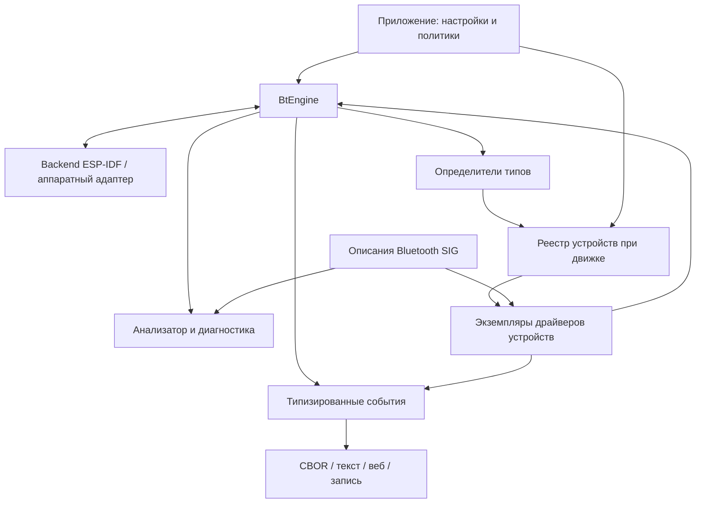

# Направление NaBTools

Последний рабочий вариант: [подключаемый SIG, прямые outputs/Action и владение BT](readme_sig_outputs_bt_ownership_ru.md).
Он заменяет ранние рекомендации о владельце Device в приложении и обязательной
типизированной прослойке перед CBOR. Подробности остаются предложением API.

Актуальное уточнение по размещению SIG и владению устройствами:
[бюджет и ответственность приложения](readme_ownership_and_sig_budget_ru.md).
Оно заменяет ранние рекомендации ниже о lifecycle/admission внутри engine
и не требует полного каталога в firmware.

Дата обсуждения: 2026-10-23. Здесь разделены требования владельца, рекомендуемые
решения и текущее состояние. Документ редактируемый; это не утверждённый ABI.

Принятое направление выделено в [ADR](adr/ADR_20261023_bt-engine-modules.md).
Для продолжения после переключения модели сначала прочитать
[передачу контекста](readme_handoff_ru.md): там собраны статусы решений,
выполненный перенос, открытые вопросы и границы следующей работы.

Уточнение 2026-10-23: владелец требует использовать полезные сведения SIG,
предусмотреть обновление upstream и работу исследовательского модуля по именам.
Конкретные интерфейсы и рекомендуемый workflow изложены в
[предложении API/SIG](readme_interfaces_proposal_ru.md); реализации пока нет.

## Подтверждённое направление

Владелец подтвердил центральный движок BT, работающий с железом, и подключаемые
к нему модули: полный анализатор, определители известных типов, обработчики
знакомых устройств и последующие расширения. Исследование и понимание Bluetooth,
подробные описания и принты — самостоятельная ценность проекта.

Нужны удобные классы для анализа, обработки и сравнения, с копированием и без.
Прикладные направления: TPMS, HRM, другие распространённые устройства;
потенциально динамики/наушники для сигнализации. CBOR сейчас является основным
форматом межподсистемного обмена в приложениях владельца. Нужны хуки для
веб-сервера, подробных логов и состояний. В будущем 433-МГц TPMS будет выдавать
тот же прикладной CBOR-формат.

Количество колёс, сезонные комплекты, техника, хранение настроек, LVGL и веб
описаны как контекст для правильного жизненного цикла BT-объектов, а не как
задание реализовать эти подсистемы сейчас.

## Центральный движок и модули

Предлагаемое имя центрального объекта — `BtEngine`. Он единолично управляет
одним аппаратным адаптером через backend: жизненным циклом стека, GAP,
сканированием, соединениями, запросами сопряжения и планированием операций.
Приложение создаёт и останавливает движок явно; конструктор модуля не запускает
Bluetooth и не заводит скрытую глобальную задачу.

Это обычная модульная схема с backend-адаптером, реестром и явным владением.
Её преимущества — один арбитр железа, совместная работа модулей, тестируемость
и понятные границы. Цена — нужно определить очередь команд, правила подписок,
отмены и закрытия сеансов. Делать отдельный универсальный plugin framework
на первом этапе не требуется: достаточно C++-интерфейсов и явной регистрации.

| Модуль | Ответственность и граница |
|---|---|
| `core` | Адреса с типом, UUID, байтовые поля, единицы, view/snapshot, результаты разбора. Без аппаратного стека и CBOR |
| `sig` | Каталог определений, имена, поля, единицы, перечисления, ссылки на источник/версию. Уровни детализации выбираются при сборке |
| `engine` | Backend, команды, состояние BT, арбитраж запросов scan/connect, маршрутизация событий и лимиты |
| `analysis` | Расшифровка наблюдений и состояний, неизвестные поля, фильтры, сравнения, текстовый вывод |
| `recognizers` | Определение возможных типов и устойчивых идентификаторов без создания бизнес-объектов |
| `devices` | Реестр экземпляров, политики допуска, сопоставление наблюдений, жизненный цикл драйверов |
| `profiles` | TPMS, Heart Rate, Battery, Device Information и другие конкретные протоколы/профили |
| `capture` | Ограниченная запись событий и replay без железа через тот же путь анализа |
| `adapters` | CBOR, интеграция с esp_event, прикладной веб-сервер и другие получатели |
| `examples` | Исследовательский сканер, известный датчик, GATT explorer; конфигурация и представление |

Названия — предложение, а не требование сразу создать столько каталогов.
Один модуль может реализовать несколько ролей, например TPMS распознавание и
фабрику драйвера, сохраняя раздельные интерфейсы.

## Что означает «полное описание Bluetooth»

Нужно различать определение типа в стандарте и экземпляр, обнаруженный на устройстве.
`ServiceDefinition` описывает известный UUID, смысл и источник; `RemoteService`
описывает конкретный сервис с handles в конкретном сеансе. Аналогично
`CharacteristicDefinition` и `RemoteCharacteristic`, `DescriptorDefinition`
и `RemoteDescriptor`. Одинаковые UUID могут встречаться более одного раза:
поиск должен возвращать коллекцию, а идентичность экземпляра учитывать handles.

Слои исследования: GAP/advertising; GATT-сервисы, характеристики, дескрипторы,
свойства и значения; соединения/безопасность; позднее Classic/SDP и профили.
Справочник UUID предоставляет имя, но сам по себе не раскрывает формат значения.
Для расшифровки нужны схемы полей, флаги присутствия, signedness, byte order,
масштаб, единицы, перечисления и ограничения конкретного профиля.

В уже перенесённом снимке SIG есть `assigned_numbers`, `gss` и `dp`. Сейчас
генератор использует только часть assigned numbers. GSS/DP — возможный материал
для следующего генератора определений; нельзя считать их уже поддерживаемым
универсальным декодером. Proprietary UUID и неизвестные поля сохраняются в raw
виде с явным статусом «неизвестно/частично распознано», без выдуманной трактовки.

Пакеты advertising не содержат полного списка реальных сервисов. GATT discovery
требует соединения; чтение может быть недоступно или требовать защиты. Анализатор
показывает возможности и полученные результаты, а активные операции выполняет
по явно включённой политике. Он не обещает promiscuous перехват чужих соединений
или полную видимость нижних уровней, которых backend не предоставляет.

Предлагаемые профили каталога: коды/короткие имена для компактной прошивки,
полные определения для исследования, внешнее дополнение длинных текстов на ПК.
Публичный интерфейс одинаков, доступность подробностей указывается явно.

## Представления, копирование и сравнение

Предлагаемые пары: `AdvertisementView`/`Advertisement`, `ValueView`/`Value`,
`EventView`/`EventSnapshot`. Владеющий объект даёт `.view()`, представление —
явную операцию создания копии. Представление не переживает callback/исходный
буфер; очередь хранит ограниченные собственные байты, а view создаётся заново
при чтении. Простое копирование структуры, содержащей span, владения не даёт.

При анализе полезны разные сравнения: точные байты, семантические поля, изменения
с учётом маски динамических данных. Смешивать их в один неоднозначный `==` не
следует. Снимки сохраняют время, RSSI, тип адреса, источник, полноту/усечение,
результат разбора. Повторные AD-блоки и исходный порядок сохраняются.
Extended advertising требует отдельной ограниченной сборки фрагментов; статус
последнего фрагмента COMPLETE сам по себе не означает целый AD-документ.

## Кто создаёт конкретное устройство

Рекомендация: реестр устройств при движке владеет экземплярами; распознаватель
возвращает результат распознавания, а фабрика создаёт драйвер только после
решения политики допуска. Это отделяет найденное, распознанное и управляемое.

| Сценарий | Создание и срок жизни |
|---|---|
| Известный настроенный датчик | Приложение загружает конфигурацию и просит реестр создать экземпляр/ожидание до первого пакета. Начальное состояние: данных ещё нет |
| Неизвестный эфир | Ограниченная запись наблюдения; тяжёлый драйвер на каждый MAC не создаётся |
| Тип распознан | Кандидат с доказательствами: UUID, сигнатура, поля, возможная идентичность. Не означает автоматическую привязку к колесу |
| Исследовательский режим | Политика может автоматически создавать временные экземпляры с лимитом, TTL и явной стоимостью активных операций |
| Пользователь выбрал устройство | Приложение принимает/сохраняет привязку, реестр переводит экземпляр в постоянное отслеживание |
| Датчик исчез | Экземпляр настроенного устройства остаётся; данные становятся устаревшими. Запись наблюдения и соединение могут завершиться отдельно |
| Удалена конфигурация/модуль | Отмена операций, отключение подписок, завершение сеанса и освобождение экземпляра; поздние callbacks не обращаются к уничтоженному объекту |

Определитель типа и обработчик конкретного экземпляра — разные роли.
Один драйвер экземпляра может объединять несколько сервисов/характеристик.
Результат распознавания может быть неоднозначным; порядок подключения модулей
не должен молча выбирать первого победителя. Нужны правила приоритета и
диагностика причин совпадения. Анализатор наблюдает пакет независимо от того,
успешно ли его разобрал прикладной драйвер.

Идентификаторы различаются: адрес и его тип; протокольный ID датчика; локальный
`DeviceId`; прикладное назначение вроде «переднее левое». Для RPA нужен механизм
идентификации, предоставляемый стеком/профилем; одинаковый тип или похожие поля
не доказывают, что это тот же прибор. Сеанс соединения имеет собственное поколение,
чтобы handles/уведомления старого соединения не попадали в новое.

Для TPMS приложение хранит технику, колёса, сезонные наборы и соответствия
`позиция → источник датчика`. BT-драйвер хранит протокольное состояние своего
датчика. Будущий 433/CAN драйвер может выдавать ту же предметную модель измерения,
но не должен наследовать BT-сеанс или притворяться Bluetooth-устройством.
Рекомендуется вынести общую предметную схему TPMS на уровень приложения/общего
контракта сенсоров, когда появится второй транспорт. Сейчас схема реализована
в модуле TomTom; прежняя плоская реализация удалена, см. [аудит](readme_retired_code_ru.md).

## CBOR и хуки

Рекомендация: сохранить CBOR основным контрактом на границах подсистем ваших
приложений и сделать адаптер CBOR первым полноценным потребителем событий nabtools.
Внутри движка и драйверов удобнее типизированные C++-значения: ими проще пользоваться,
проверять протоколы и тестировать без постоянного encode/decode.

| Вариант | Плюсы | Цена / рекомендация |
|---|---|---|
| CBOR обязателен везде, включая механизм BT | Единый формат и привычные очереди | Связь аппаратного API с транспортом, кодеками, аллокациями и политикой очередей; расширять на все проекты автоматически не рекомендую |
| Типизированное ядро + поддерживаемый CBOR-адаптер | Удобные классы, переносимость, единая интеграция ваших проектов | Нужно один раз определить события и их кодирование; рекомендуемый вариант |
| Только произвольные пользовательские callbacks | Минимальная библиотека | Каждый проект изобретает схему заново; недостаточно для повторного использования |

Хуки должны охватывать наблюдения, распознавание, измерения, изменения состояния,
результаты команд, ошибки и структурированную диагностику. Подписка возвращает
RAII-токен; контракт определяет поток выполнения, владение и отписку. Медленный
веб-клиент/логгер получает собственную ограниченную очередь и счётчик потерь.
Callback не пишет напрямую в сокет и не вызывает LVGL из BT task.

Подробный текст строится из структурированной записи диагностическим renderer:
категория, уровень, время, устройство/сеанс/операция, raw и разобранные поля.
Так один и тот же материал подходит serial, вебу, CBOR, файлу и replay.
Уровень подробности, фильтры и лимиты управляются явно. Потери диагностических
пакетов не должны маскироваться под достоверный полный захват.

Для CBOR нужен версионированный envelope: тип/версия схемы, источник, идентичность,
время/свежесть, данные/единицы и результат разбора. Имена ключей пока не закреплены.
Общий TPMS payload сможет быть одинаковым для BT и 433; сведения о транспорте
останутся в envelope. Несколько потребителей одной очереди конкурируют за
сообщения: для LVGL, логгера и веба нужен fan-out или отдельные подписки.
Сырые аудиоданные в перспективе требуют отдельного потока буферов, а не упаковки
каждого аудиоблока в общий диагностический CBOR event.

## Ещё полезные модули

- GATT explorer с деревом реальных сервисов, характеристик, дескрипторов,
  чтением/подписками и отдельным разрешением на запись.
- Capture/replay с корпусом реальных обезличенных пакетов: разбор можно
  отлаживать на ПК без присутствия датчика.
- Изменения и сравнение снимков: что изменилось после соединения, нажатия,
  смены режима; отдельно измеренные факты и гипотезы декодера.
- Арбитр scan/connect: модули выражают спрос, движок выбирает совместимые
  параметры, сообщает конфликты и лимиты, не запускает параллельно один и тот же scan.
- Capability-модель backend: LE/Classic, GATT, PHY, extended advertising,
  доступность security/SDP/audio и поддерживаемые ограничения.

HRM — подходящий следующий пример после advertising: стандартный Heart Rate
Service проверяет scan → connect → discovery → subscribe → decode → disconnect.
Потом Battery Service и Device Information могут дополнять уже существующий
экземпляр устройства.

Аудио требует отдельного направления. Для передачи на обычную A2DP-колонку
нужна роль Source и Bluetooth Classic у контроллера/стека. ESP32-S3 Classic
не поддерживает. LE Audio — отдельные профили/транспорт/кодеки и аппаратные
возможности; наличие BLE или «Bluetooth 5» не доказывает поддержку аудио.
Для сигнализации нужно также определить поведение при недоступном аудиоканале;
это прикладная политика, не ответственность TPMS-парсера.

## Порядок последующих работ

1. Устранить ошибки безопасности парсера/справочников/строк и закрепить корпус
   рекламных пакетов тестами. Подробные диагностические возможности сохранить.
2. Ввести view/snapshot и SIG Definition API, сохранив старые фасады на время миграции.
3. Выделить BtEngine/backend и подписки; перенести scan из приложений в движок.
   Проверить одновременную работу анализатора и TPMS-модуля.
4. Реестр устройств, фабрики, известные конфигурации и временные наблюдения;
   потом GATT/HRM как проверка жизненного цикла с соединениями.
5. CBOR-адаптер и capture/replay, затем исследовательский веб-интерфейс через
   внешний сервер. Прикладные TPMS-настройки и аудио развивать отдельными задачами.

Источник фактов о платформах: [Espressif Bluetooth overview](https://docs.espressif.com/projects/esp-idf/en/stable/esp32s3/api-guides/bt-architecture/overview.html).
Профиль: [Bluetooth SIG Heart Rate Service](https://www.bluetooth.com/specifications/specs/heart-rate-service-1-0/).
Роль аудио: [официальный пример A2DP Source](https://github.com/espressif/esp-idf/tree/master/examples/bluetooth/bluedroid/classic_bt/a2dp_source).
